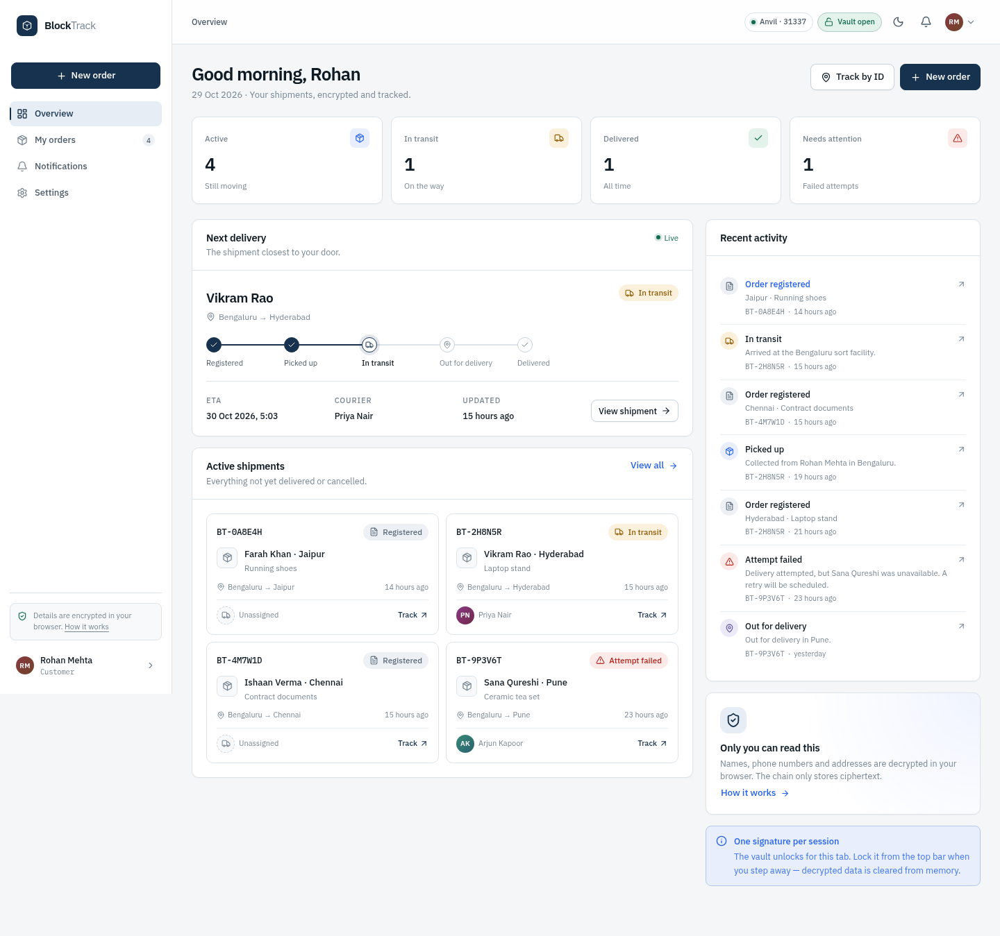
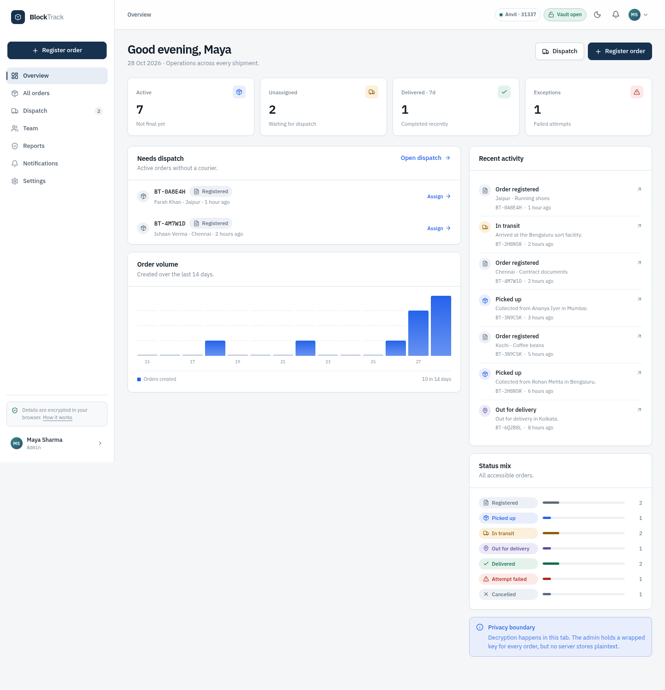
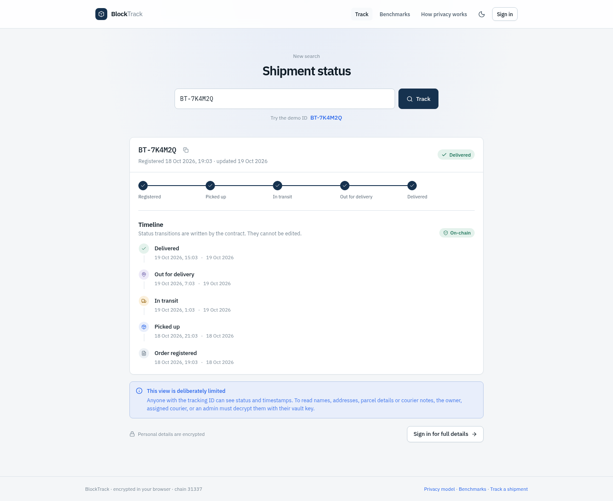
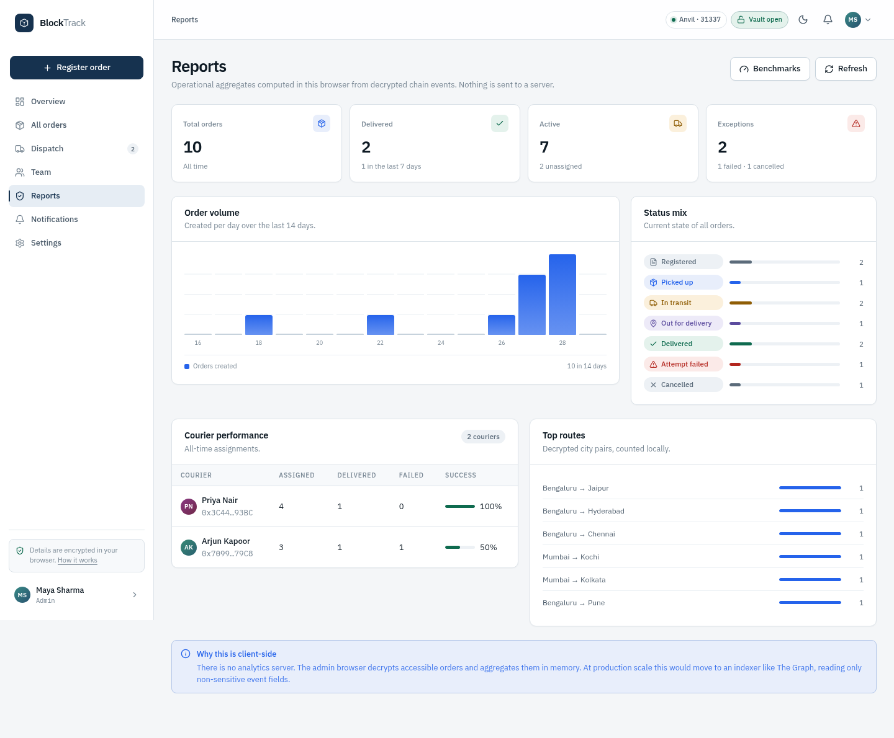
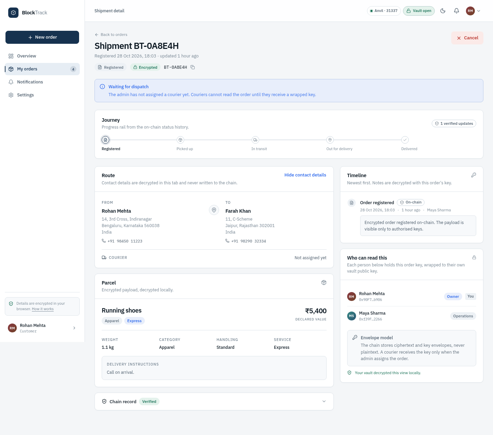

# BlockTrack

**Privacy-preserving parcel tracking on a public chain. No backend.**

Status updates are verifiable and immutable. Names, phone numbers, addresses, parcel
contents and courier notes are encrypted in the browser before they touch the chain.
The only people who can decrypt an order are its customer, the operations admin, and the
courier assigned to it.

Built for a local Anvil demo with Foundry, React and client-side AES-256-GCM + ECIES.
There is no API, no database, no account server, and no plaintext ever leaves the tab.



---

## What this is (and is not)

This is a working privacy-focused prototype, not a production logistics platform.

- **No backend.** A static React app talks directly to an Ethereum RPC endpoint.
- **The chain is the source of truth.** Orders, status history, roles and wrapped keys are on-chain.
- **Encryption is the access control.** Write permissions are enforced by the contract; read permissions are enforced cryptographically.
- **The public tracker is status-only.** Anyone with a tracking ID sees state and timestamps, never personal data.
- **The demo data is fictional.** Anvil's publicly known development keys are used for one-click demo accounts.

---

## Quick start

### Prerequisites

- Node.js 20+
- [Foundry](https://book.getfoundry.sh/) (`forge`, `anvil`, `cast`)
- Chrome or Chromium, only for `npm run test:e2e` and `npm run screens`

> Fresh clone? The Foundry libraries (`forge-std`, OpenZeppelin) are git submodules:
> `git clone --recursive <repo>` or `git submodule update --init --recursive`.

### Run it

```bash
npm install          # installs root tooling and the frontend via postinstall
npm run dev
```

`npm run dev` does all of the following:

1. Starts Anvil on `http://127.0.0.1:8545` with a genesis timestamp backdated 45 days.
2. Compiles `src/BlockTrack.sol`.
3. Deploys the contract and writes `frontend/public/deployment.json`.
4. Seeds 10 encrypted orders, 7 assignments and 21 status updates.
5. Starts Vite at **http://127.0.0.1:5173**.

Open the app and pick a demo account. No MetaMask is required.

> If the app is already running against an existing chain, `npm run dev` reuses it.
> To start over with a fresh, backdated chain, stop the dev server with `Ctrl+C` and run
> `npm run dev` again.

### Demo accounts

These are seeded Anvil accounts. Their private keys are public development keys and have
no value. They exist only on chain 31337.

| Persona | Role | Wallet |
| --- | --- | --- |
| **Maya Sharma** | Admin / operations | `0xf39Fd6e51aad88F6F4ce6aB8827279cffFb92266` |
| **Arjun Kapoor** | Courier · Bengaluru | `0x70997970C51812dc3A010C7d01b50e0d17dc79C8` |
| **Priya Nair** | Courier · Mumbai | `0x3C44CdDdB6a900fa2b585dd299e03d12FA4293BC` |
| **Rohan Mehta** | Customer · Bengaluru | `0x90F79bf6EB2c4f870365E785982E1f101E93b906` |
| **Ananya Iyer** | Customer · Mumbai | `0x15d34AAf54267DB7D7c367839AAf71A00a2C6A65` |
| **Kabir Shah** | Customer · Delhi | `0x9965507D1a55bcC2695C58ba16FB37d819B0A4dc` |

The full keys live in [`frontend/src/shared/personas.js`](frontend/src/shared/personas.js).
A real deployment would never ship keys in the frontend.

---

## The privacy model

### One order, one key, one envelope per person

```
plaintext order payload
        │
        │  AES-256-GCM, random 32-byte order key K
        ▼
   ciphertext ──────────────────────────────► BlockTrack contract
        +                                        (ciphertext, status,
   K wrapped with the customer's public key      history, addresses)
   K wrapped with the admin's public key
   K wrapped with the courier's public key  ◄── added only at assignment
```

- Each order gets a fresh random **AES-256-GCM** key.
- The payload and courier notes are encrypted in the browser. The tracking ID is bound as
  authenticated additional data, so ciphertext cannot be moved to another order.
- The order key is wrapped with **ECIES (secp256k1)** for every authorised reader.
- The contract stores only ciphertext, wrapped keys, addresses and status.
- The public tracker calls dedicated public getters that return status and timestamps only.

### Where the vault key comes from

No password and no key server. The first time a wallet unlocks in a tab, it signs a fixed,
domain-separated message. That signature is stretched with HKDF-SHA256 into a secp256k1
private key — the **vault key**. Its public half is registered on-chain as the encryption
key.

- The signature is not a transaction and costs no gas.
- The private key exists only in memory and is cleared when the vault is locked.
- Demo personas derive deterministic keys from their Anvil wallets.
- A browser wallet asks for the signature once per session.

### Who can see what

| | Orders visible | Personal details | Notes / ETA | How access is granted |
| --- | --- | --- | --- | --- |
| **Customer** | Own orders | Own orders | Own orders | Order key wrapped at creation |
| **Courier** | Assigned orders | Assigned orders | Assigned orders | Admin wraps the key at assignment |
| **Admin / operations** | All orders | All orders | All orders | Key wrapped at creation for operations |
| **Public** | Status by tracking ID | None | None | No envelope exists |

### What is on-chain

Public: tracking ID, owner and courier addresses, status transitions, timestamps, display
names, encryption public keys, order ciphertext length, wrapped key envelopes.

Encrypted: sender and recipient names, phone numbers, full addresses, parcel description,
weight, declared value, special instructions, courier notes, locations and ETAs.

See [`docs/PRIVACY.md`](docs/PRIVACY.md) for the threat model, revocation limits, metadata
leakage and the honest caveats.

---

## The app

### Customer

- Dashboard with active shipments, next delivery, delivery progress and recent activity.
- Create an encrypted order in a three-step flow with a local review.
- Only see orders owned by the connected wallet.
- Read the courier's decrypted timeline, ETA, location and proof-of-delivery fields.
- Cancel an order before pickup.
- Public status lookup by tracking ID.

### Admin / operations

- Every order on the contract, with a wrapped key for each one.
- Dispatch unassigned shipments and wrap the order key for a courier.
- Reassign a courier; the previous envelope is removed on-chain.
- Add and remove the courier role.
- Update any non-final shipment, with an encrypted note.
- Reports: volume, status mix, courier completion and top routes — computed locally.
- Customer directory and team management.

### Courier

- A queue of only the orders assigned to their wallet.
- Decrypt recipient details only after assignment.
- Move the shipment through the contract's state machine and add an encrypted note.
- A revoked courier loses the on-chain envelope (but past reads cannot be un-seen).

### Public

- Status, progress rail and timestamps by tracking ID.
- No names, addresses, parcel details, notes or ETAs.
- Try `BT-7K4M2Q` in the demo.

---

## Status machine

The contract enforces legal transitions.

```
Created ──► PickedUp ──► InTransit ──► OutForDelivery ──► Delivered
   │              │            │              │
   │              │            │              └──► FailedAttempt ──► OutForDelivery (retry)
   │              │            │
   │              └────────────┴──────────────┴──► Cancelled (admin, non-final)
   │
   └──► Cancelled (owner before pickup, or admin)
```

| Index | Key | UI label |
| --- | --- | --- |
| 0 | `Created` | Registered |
| 1 | `PickedUp` | Picked up |
| 2 | `InTransit` | In transit |
| 3 | `OutForDelivery` | Out for delivery |
| 4 | `Delivered` | Delivered |
| 5 | `FailedAttempt` | Attempt failed |
| 6 | `Cancelled` | Cancelled |

---

## Architecture

```
┌──────────────────────────────────────────────────────────────────┐
│ Browser                                                          │
│                                                                  │
│  React 18 + Vite + TanStack Query                                │
│  ├─ vault: wallet signature → HKDF → secp256k1 key (memory only)  │
│  ├─ AES-256-GCM payload / note encryption                        │
│  ├─ ECIES wrap / unwrap of per-order keys                        │
│  └─ decrypt + aggregate in memory                                │
│                                                                  │
│  static files only ── no cookies, no sessions, no API keys       │
└───────────────────────────────┬──────────────────────────────────┘
                                │ JSON-RPC (reads + signed writes)
┌───────────────────────────────▼──────────────────────────────────┐
│ Anvil / any EVM chain                                            │
│                                                                  │
│  BlockTrack.sol                                                  │
│  ├─ profiles: display name + encryption public key               │
│  ├─ orders: owner, courier, status, ciphertext                   │
│  ├─ history: status, actor, timestamp, encrypted note            │
│  ├─ wrapped keys: order → grantee → ECIES envelope               │
│  └─ roles: admin (deployer) + logistics (couriers)               │
└──────────────────────────────────────────────────────────────────┘
```

The order list is built by querying `OrderCreated` and `CourierAssigned` events directly
from the RPC, then decrypting each accessible order in the browser. At demo scale
(10 orders) this is instant. A production system would use an indexer such as The Graph
for discovery while still decrypting locally.

### Repository layout

```
src/BlockTrack.sol            Contract: roles, profiles, orders, history, key envelopes
test/BlockTrack.t.sol         34 Foundry tests
script/Deploy.s.sol           Deploy script
frontend/src/
  pages/                      Route-level screens
  components/                 UI primitives, layout and domain components
  context/                    Wallet, vault, theme and toast providers
  hooks/                      Chain reads, roles, orders, notifications
  lib/                        Formatting, status machine, contract helpers
  shared/                     Crypto, ABI, personas, pure crypto tests
  styles/                     Cold Precision token system + CSS
scripts/                      One-command dev stack, deploy, seed, E2E, screenshots
docs/                         Privacy model, viva demo, screenshots
```

### Contract API

Profiles: `registerProfile`, `updateDisplayName`, `getProfile`, `profileExists`.

Orders: `createOrder`, `createOrderFor`, `assignCourier`, `updateStatus`, `cancelOrder`,
`getOrder`, `getTrackingHistory`, `getPublicStatus`, `getPublicHistory`, `orderExists`.

Keys: `getWrappedKey`, `getKeyHolders`, `hasAccess`.

Roles: `isAdmin`, `isLogistics`, `getAdmin`, `getAdmins`, `getCouriers`,
`addLogisticsUser`, `removeLogisticsUser`.

Limits: tracking ID 32 bytes · ciphertext 8 KiB · note 2 KiB · wrapped key 256 bytes ·
display name 48 bytes · public key 65 bytes.

---

## Design

**Cold Precision** — a quiet, operational interface for sensitive data.

- Cool gray canvas, deep navy primary, one blue action accent, IBM Plex Sans + Mono.
- No gradients, glassmorphism or neon. Depth comes from borders, spacing and small shadows.
- Status uses a consistent tint + icon pair, not colour alone.
- Light and dark themes share the same tokens and spacing.
- Responsive: sidebar → off-canvas drawer + bottom navigation at mobile sizes.
- Accessible focus rings, 44px targets, labelled controls, reduced-motion support.

| | |
| --- | --- |
|  |  |
|  |  |

More in [`docs/screens`](docs/screens).

---

## Testing

```bash
npm test                 # Forge (34) + crypto (7)
npm run test:contracts   # Forge only
npm run test:crypto      # Node test runner, pure crypto helpers
```

With the dev stack running:

```bash
npm run test:e2e         # Chrome smoke test: create → dispatch → update → public → cancel → lock
npm run screens          # regenerate docs/screens from the seeded demo
```

The E2E test writes to the local chain and leaves a cancelled test order. It is meant for
the throwaway Anvil demo. `npm run screens` is read-only and expects a freshly seeded demo.

### What the tests cover

- Role isolation, profile registration and key mismatch.
- Order creation with owner + admin keys, ownership filtering and public getters.
- Legal and illegal status transitions, courier-only updates, cancellation rules.
- Assignment, reassignment, wrapped-key grants and revocation.
- AES-GCM round trips, AAD binding, ECIES wrap/unwrap and vault derivation.
- End-to-end browser flows with the real encrypted chain.

---

## Production notes

This prototype makes deliberate trade-offs that a real deployment must revisit:

- **Storage** — 8 KiB of ciphertext per order is fine for a demo but expensive on
  Ethereum. Store the payload on IPFS/Arweave and anchor only the CID + hash on-chain.
- **Indexing** — direct event scanning is replaced by an indexer that reads only
  non-sensitive fields.
- **Revocation** — reassignment removes the on-chain envelope, but a reader who already
  decrypted data retains it. True revocation requires key rotation and re-encryption.
- **Admin trust** — operations holds a wrapped key for every order. A real system should
  use threshold/multi-party key management and an audited access policy.
- **Metadata** — addresses, timing, order volume and ciphertext size are public. Privacy
  on a public chain is never absolute.
- **Key recovery** — losing the wallet loses the vault key. The demo has no recovery
  server. Production needs a deliberate, secure recovery design.
- **Regulation** — ciphertext, wallet addresses and immutable audit trails can still be
  personal data. “Status-only public” is a product choice, not a GDPR compliance claim.
- **Wallet UX** — the vault signature is one extra prompt per session; a production flow
  should explain it clearly and handle wallets with non-deterministic signing.
- **Audit** — the contract and client crypto are unaudited. Do not use with real PII.

---

## Docs

- [Privacy model](docs/PRIVACY.md) — threat model, key derivation, revocation, limits.
- [Viva demo](docs/VIVA.md) — a 5-minute walkthrough and likely questions.
- [Screens](docs/screens) — desktop, dark and mobile captures.

## Stack

Foundry · Solidity 0.8.24 · OpenZeppelin 5 · React 18 · Vite 5 · React Router 7 ·
TanStack Query 5 · ethers 6 · eciesjs · IBM Plex · Lucide.
